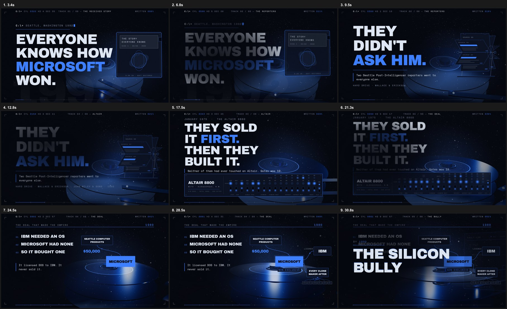
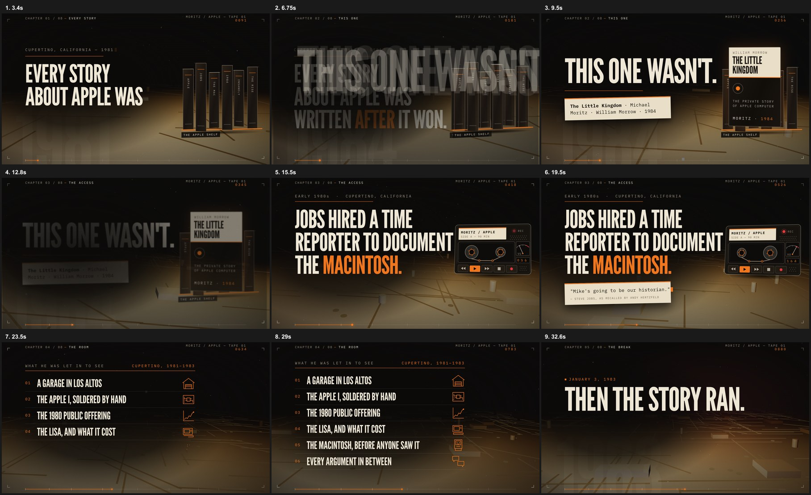
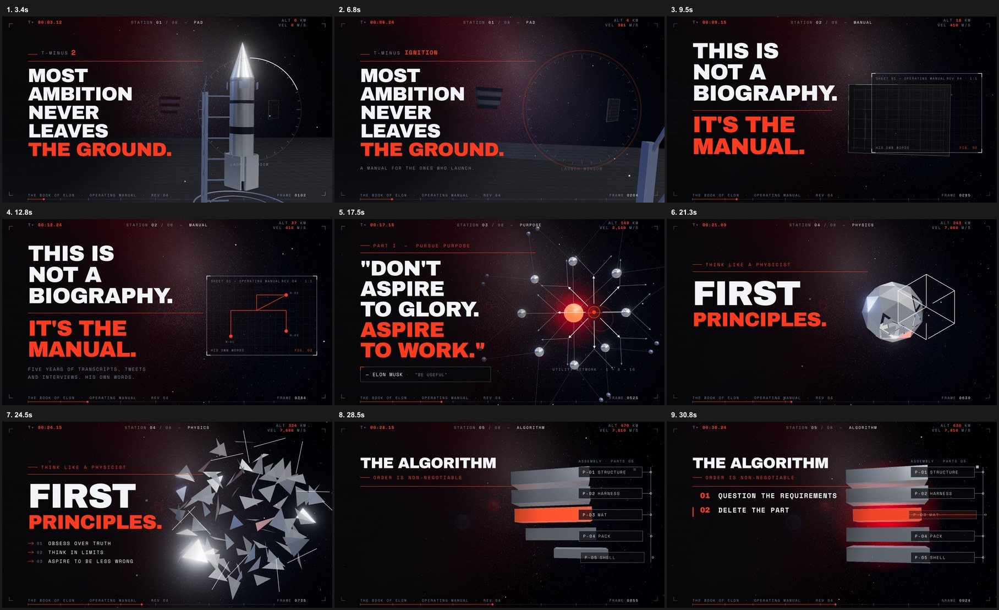

# Cinematic Book Trailers & Open-Source Soundtracks

[](./LICENSE)
[](./LICENSE)
[](https://hyperframes.heygen.com)
[](https://threejs.org)
[](https://deepmind.google/technologies/lyria/)
[](https://github.com/Ahmet-Dedeler/book-trailers/releases/tag/v1.0.0)

A collection of open-source cinematic book trailers, WebGL compositions, and original instrumental soundtracks for defining technology history books:

1. **The Little Kingdom** (*Michael Moritz, 1984*) — The Apple origin story before the Mac.
2. **Hard Drive: Bill Gates and the Making of the Microsoft Empire** (*James Wallace & Jim Erickson, 1992*) — The unauthorized investigation of the 1980 IBM DOS deal.
3. **The Book of Elon** — First-principles engineering, orbital mechanics, and SpaceX/Tesla execution.

All trailers are built as deterministic web-native compositions using **HyperFrames**, **Three.js**, and **GSAP**, scored with custom AI-generated soundtracks via **Google Lyria 2** mastered through `ffmpeg`.

---

## Visual Previews

### 1. Hard Drive: Bill Gates and the Making of the Microsoft Empire
> *"Microsoft's empire was not won with better code — it was bought for $50,000 and negotiated into a licence nobody else thought to ask for."*



* **Book:** *Hard Drive: Bill Gates and the Making of the Microsoft Empire* by James Wallace & Jim Erickson (John Wiley & Sons, 1992).
* **Protagonist:** Bill Gates, Paul Allen, Steve Ballmer, IBM PC project team (Boca Raton).
* **Visual Direction:** A cold, mechanical 1980s monochrome aesthetic with cobalt blue accents. The piece is anchored by an unbroken 60-second 3D hard-disk platter assembly rendered in WebGL, Altair 8800 toggle panels, and licensing flowcharts.
* **Directory:** [`hard-drive/`](./hard-drive/)
* **Soundtrack:** 4-movement Lyria-2 analog synth score combined with a procedural industrial sound-design stem ([`hard-drive/assets/mix.mp3`](./hard-drive/assets/mix.mp3)).
* **Watch Renders:**
  * [Standard 1080p Cut](./hard-drive/renders/hard-drive-trailer-1080p.mp4)
  * [Web Preview Cut](./hard-drive/renders/hard-drive-v4-web.mp4)
  * [Download 4K 60fps Master (280 MB)](https://github.com/Ahmet-Dedeler/book-trailers/releases/download/v1.0.0/hard-drive-v4-4k.mp4)

---

### 2. The Little Kingdom: The Private Story of Apple Computer
> *"Every Apple account you have read was written after Apple won. This one wasn't."*



* **Book:** *The Little Kingdom: The Private Story of Apple Computer* by Michael Moritz (William Morrow, 1984; reissued 2009 as *Return to the Little Kingdom*).
* **Protagonists:** Steve Jobs, Steve Wozniak, Andy Hertzfeld, Michael Moritz.
* **Visual Direction:** Warm editorial ink on newsprint, print typography, and the iconic 1977 six-color Apple spectrum payoff.
* **Directory:** [`the-little-kingdom/`](./the-little-kingdom/)
* **Soundtrack:** Restrained minor-key piano ostinato over a warm analog tape drone ([`the-little-kingdom/assets/score.mp3`](./the-little-kingdom/assets/score.mp3)).
* **Watch Renders:**
  * [Original Typographic Cut](./the-little-kingdom/renders/the-little-kingdom-trailer.mp4)
  * [3D 1080p Cut](./the-little-kingdom/renders/the-little-kingdom-trailer-3d-1080p.mp4)
  * [v4 1080p Master Cut](./the-little-kingdom/renders/the-little-kingdom-v4-1080p.mp4)
  * [Download 4K Master (206 MB)](https://github.com/Ahmet-Dedeler/book-trailers/releases/download/v1.0.0/the-little-kingdom-v4-4k.mp4)

---

### 3. The Book of Elon
> *"First principles over analogy. The physics engine doesn't care about your conventional wisdom."*



* **Subject:** First-principles engineering, SpaceX orbital mechanics, Tesla automation algorithm, and hardcore manufacturing sprints.
* **Visual Direction:** Real-time 3D solar system orbital mechanics rendered in Three.js, deep-space perspective cameras, and a live HUD telemetry overlay.
* **Directory:** [`the-book-of-elon/`](./the-book-of-elon/)
* **Soundtrack:** Low ticking pulse building into heavy industrial bass drops and ascending string sequences ([`the-book-of-elon/assets/mix.mp3`](./the-book-of-elon/assets/mix.mp3)).
* **Watch Renders:**
  * [Original 2D Cut](./the-book-of-elon/renders/the-book-of-elon-trailer.mp4)
  * [3D 1080p Cut](./the-book-of-elon/renders/the-book-of-elon-3d.mp4)
  * [Web Preview Cut](./the-book-of-elon/renders/the-book-of-elon-v4-web.mp4)
  * [Download 4K Master (223 MB)](https://github.com/Ahmet-Dedeler/book-trailers/releases/download/v1.0.0/the-book-of-elon-v4-4k.mp4)

---

## Open Soundtrack Catalog (Royalty-Free / CC BY 4.0)

All soundtracks in this repository are available under **Creative Commons Attribution 4.0 (CC BY 4.0)**. You can freely use them in your own YouTube videos, podcasts, games, and films with attribution.

### Track List & Downloads
| Track | Style | Instrumentation | File Link |
| :--- | :--- | :--- | :--- |
| **The Little Kingdom Theme** | Documentary / Investigative | Minor-key piano, tape warmth, analog sub-drone | [`assets/score.mp3`](./the-little-kingdom/assets/score.mp3) |
| **Hard Drive: The Monopoly** | Industrial / Mechanical | Pulsing sequencers, metallic hits, cobalt drone | [`assets/mix.mp3`](./hard-drive/assets/mix.mp3) |
| **First Principles (Elon Theme)** | Cosmic / Tense Build | Ticking pulses, ascending arpeggiators, sub-bass drop | [`assets/mix.mp3`](./the-book-of-elon/assets/mix.mp3) |

### Generation Recipe (Google Lyria 2 + ffmpeg)
Every track was generated using the `google/lyria-2` music foundation model through `hcai`, then crossfaded and normalized:

```bash
# Generate Movement 1 (Lyria 2 outputs ~32.8s clips)
hcai music generate \
  --model google/lyria-2 \
  --negative-prompt "vocals, singing, cheerful, upbeat pop, EDM, distorted guitar, busy drums" \
  "Cinematic documentary trailer score, 60 seconds, serious and restrained. Sparse minor-key piano ostinato over a low analog synth drone with tape warmth. Tension builds slowly with cold sustained strings into a rising swell..." \
  --out assets/part-1.wav

# Generate Movement 2
hcai music generate \
  --model google/lyria-2 \
  --negative-prompt "vocals, singing, cheerful pop, drums" \
  "Dark cinematic trailer score, second movement. Opens on a hard low percussive impact and sub-bass drop, resolving to a single piano note over drone..." \
  --out assets/part-2.wav

# Crossfade & Loudness Normalize (EBU R128)
ffmpeg -i assets/part-1.wav -i assets/part-2.wav \
  -filter_complex "[0:a]atrim=0:31.7,asetpts=N/SR/TB[a];[1:a]atrim=0:29.5,asetpts=N/SR/TB[b];[a][b]acrossfade=d=1.2:c1=tri:c2=tri[m];[m]afade=t=in:st=0:d=2,afade=t=out:st=57:d=3,loudnorm=I=-15:TP=-1.5:LRA=11[out]" \
  -map "[out]" -b:a 192k assets/score.mp3
```

---

## Technical Architecture

* **Framework:** [HyperFrames](https://hyperframes.heygen.com) — Deterministic code-to-video compiler.
* **3D Graphics:** [Three.js r181](https://threejs.org) with custom procedural geometry and RoomEnvironment PBR lighting.
* **Choreography:** [GSAP (GreenSock)](https://gsap.com) paused timelines tied to framework timecode events (`hf-seek`).
* **Audio Mastering:** FFmpeg dual-movement crossfade and loudness normalization to broadcast standards (-15 LUFS).

---

## Quickstart & Local Development

### 1. Clone the repository
```bash
git clone https://github.com/Ahmet-Dedeler/book-trailers.git
cd book-trailers
```

### 2. Run a trailer in live development mode
```bash
cd hard-drive # or the-little-kingdom, the-book-of-elon

# Install dependencies
npm install

# Start interactive browser preview
npm run dev
```

### 3. Verify determinism & render to MP4
```bash
# Automated audit (layout, timing, contrast, determinism)
npm run check

# Render locally to MP4
npm run render
```

---

## Releases & Downloads

Full uncompressed 4K master files (exceeding GitHub's 100 MB single-file git limit) are available for direct download on the **[Releases Tab](https://github.com/Ahmet-Dedeler/book-trailers/releases/tag/v1.0.0)**:
* `hard-drive-v4-4k.mp4` (267 MB)
* `the-book-of-elon-v4-4k.mp4` (213 MB)
* `the-little-kingdom-v4-4k.mp4` (197 MB)
* `hard-drive-v4-1080p.mp4` (101 MB)
* `the-book-of-elon-v4-1080p.mp4` (103 MB)

---

## License

* **Code & Compositions:** [MIT License](./LICENSE)
* **Audio & Video Media:** [Creative Commons Attribution 4.0 International (CC BY 4.0)](./LICENSE)
* **Attribution:** "Music & Visuals by Ahmet Dedeler (github.com/Ahmet-Dedeler/book-trailers)"
